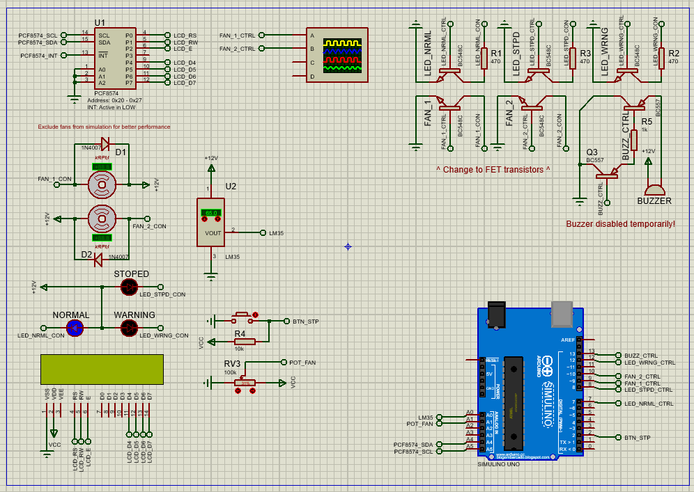
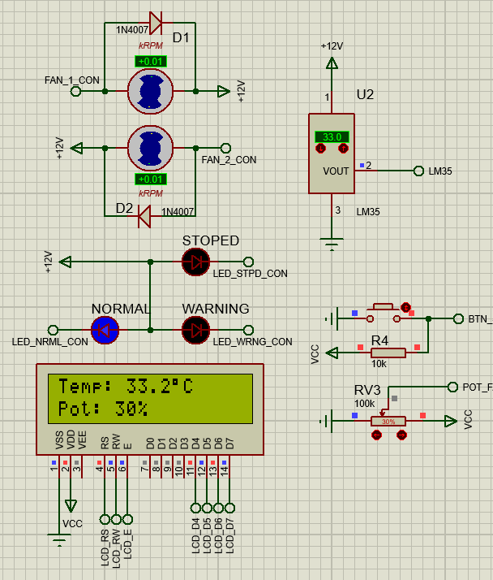
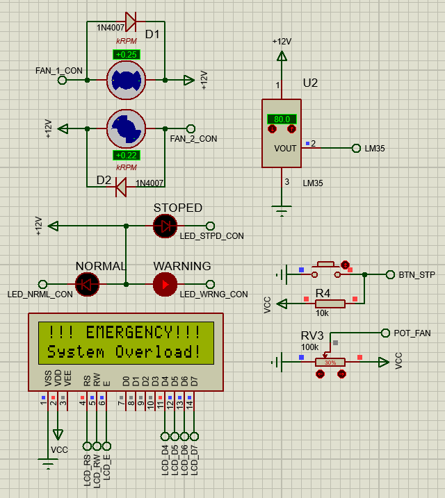

# Arduino controls fans based on temperature (completed version)

> Fork of [Jk289/Arduino-controls-fans-based-on-temperature](https://github.com/Jk289/Arduino-controls-fans-based-on-temperature) (2018, marked *"In progress"*).
> The circuit and the Proteus schematic are by the original author.
> In this fork I completed and fixed the firmware, added unit tests and wrote a report, as a course project for **MCE201** at FPT University (March 2026).



## What the system does

- An **LM35** sensor reads the temperature.
- **Fan 1 follows the temperature:** 33 % below 45 °C, rising linearly to 100 % at 75 °C (10-bit PWM with TimerOne). The 33 % floor keeps the DC motor from stalling.
- **Fan 2 follows a potentiometer.**
- A **stop button** pauses or resumes Fan 1, and the *Stopped* LED shows it.
- A **16x2 LCD over I2C** (PCF8574) shows the temperature and the potentiometer level.
- **Emergency mode above 75 °C:** both fans run at 100 %, the *Warning* LED and the buzzer turn on, and the LCD shows `!!! EMERGENCY!!!`. The system stays in this mode until the temperature drops to **70 °C** (5 °C hysteresis).

## What I changed

Compared with the original code:

| Problem in the original | Fix in this fork |
|---|---|
| Sensor reading and PWM updates ran inside a Timer1 interrupt every 150 µs, which froze the system | `Update_measures()` now runs in the main loop |
| The stop-button interrupt was commented out (*"Maybe doesn't work properly"*) | New `StopFan_isr()` on INT0 (falling edge) with 250 ms debounce and a `volatile` flag |
| The emergency routine set the fans to `HIGH` (= 1 out of 1023, almost off) | Fans are set to `1023` (100 %) |
| The emergency routine did not start and end correctly (listed under *"To Implement"*) | It re-reads the temperature and holds until 70 °C (hysteresis) |
| Temperature stored as `byte` (no decimals), no upper PWM limit | `float` temperature with 1 decimal on the LCD, PWM limited to 338–1023 |
| No emergency message on the LCD | LCD shows `!!! EMERGENCY!!!` / `System Overload!` |
| The Proteus project loaded firmware from `Y:\Documents\...` on the author's computer | It loads `.pio/build/uno/firmware.hex` from this repository |
| No tests | Unity unit tests for the PWM mapping in `test/test_man.cpp` |

**Update, Nov 2026:** fixed a bug where the alarm stayed on forever if the temperature cooled down slowly through 75 °C. The emergency loop now holds until 70 °C.

## Simulation results (Proteus)

| Normal mode (33 °C) | Emergency mode (80 °C) |
|---|---|
|  |  |

## How to run

### Proteus simulation (no build needed)

1. Download or clone this repository and keep the folder structure.
2. Open `Proteus Simulation/Arduino control fans with LM35 temperature based.pdsprj` in Proteus 8. It needs the SIMULINO UNO Arduino library for Proteus.
3. Press **Run**. The project loads `Arduino controls fans based on temperature/.pio/build/uno/firmware.hex`.

The files named *"for Proteus7"* are the original 2018 design for Proteus 7.

### Build the firmware (PlatformIO)

```bash
cd "Arduino controls fans based on temperature"
pio run     # builds .pio/build/uno/firmware.hex
pio test    # runs the unit tests on a connected Arduino Uno
```

## Pin map

| Arduino | Connected to |
|---|---|
| A0 | LM35 output |
| A1 | Potentiometer (Fan 2 speed) |
| A4 / A5 | SDA / SCL of the PCF8574 (LCD) |
| D2 | Stop button (INT0) |
| D7 / D8 / D12 | Normal / Stopped / Warning LED drivers |
| D9 / D10 | Fan 1 / Fan 2 drivers (Timer1 PWM) |
| D13 | Buzzer driver (LOW = on) |

## Report

The full report (system model, ADC conversion, PWM mapping, interrupt and hysteresis design, simulation results, limitations) is in [docs/Smart_Fan_Control_Report.pdf](docs/Smart_Fan_Control_Report.pdf).

## Credits

- Original project, circuit and Proteus schematic: [Jk289](https://github.com/Jk289) (2018)
- Firmware fixes, unit tests and report: Nguyen Pham Tuan (2026)
